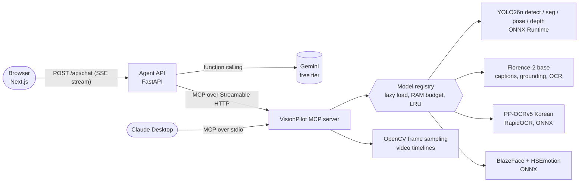

# VisionPilot

**An AI agent that answers questions about images and videos by choosing which vision models to run.**
Ask "How many people are in this queue and how long has it been this long?" or "Read this Korean menu and
translate it": the agent plans, calls tools on its own MCP server, combines the results, and answers with the
regions it relied on highlighted on the image.

Everything runs on a CPU laptop (no GPU) with pretrained models and free tools.

<!-- Record with ScreenToGif (free), save as docs/demo.gif, then uncomment:

-->

## What it does

- **Plans with tools, not guesses.** Gemini decides which of 10 vision tools to call, in what order, and passes
  results between them (for example the boxes from detection into depth estimation to measure distance).
- **Shows its work.** Every step streams to the browser as it happens, with the tool, its arguments, a one-line
  result and the time it took.
- **Links the answer to pixels.** Phrases in the answer are tied to tool results. Hovering "4 people" lights up
  those four boxes; clicking a moment in a video answer jumps the player there.
- **Works in Claude Desktop too.** The vision tools are a standard MCP server, so any MCP client can use them.

Demo scenarios: **retail** (count shoppers, queue length over time), **Seoul streets** (read Korean signs and menus,
translate, describe), **meetings and classrooms** (faces and apparent expressions over time).

## Architecture



| Part | Stack | Role |
|---|---|---|
| `mcp_server/` | Python 3.11, official MCP SDK v2 (`MCPServer`), Pydantic | 10 vision tools with typed JSON output, caching, latency logging |
| `backend/` | FastAPI, google-genai, MCP client, SSE | Agent loop: plan, call tools, stream trace, structured final answer |
| `frontend/` | Next.js 16, Tailwind v4, Radix (shadcn/ui style), Motion | Viewer with overlays, live trace, linked answer, video timeline |
| `evals/` | JSONL + scorer | 25 questions with expected tools and answer checks |

## Vision tools

| Tool | Model | Returns |
|---|---|---|
| `detect_objects` | YOLO26n (ONNX) | Boxes, confidences, counts for 80 COCO classes |
| `segment_objects` | YOLO26n-seg (ONNX) | Mask polygons, share of the image each label covers |
| `estimate_pose` | YOLO26n-pose (ONNX) | 17 keypoints per person and a rough posture |
| `estimate_depth` | YOLO26n-depth (ONNX) | Metric depth, distance inside given boxes, depth map |
| `describe_image` | Florence-2 base-ft | Scene description at three detail levels |
| `find_phrase` | Florence-2 grounding | Boxes for anything described in words |
| `read_text` | Florence-2 OCR | English text lines with positions |
| `read_korean_text` | PP-OCRv6 detector + PP-OCRv5 Korean recognizer | Korean text lines in reading order |
| `analyze_faces` | MediaPipe BlazeFace (tiled) + HSEmotion | Faces and apparent expression probabilities |
| `process_video` | OpenCV sampling + YOLO26n or faces | Timeline of counts, peak, how long the current count has lasted |

## Design decisions

- **MCP as the tool boundary.** The agent and Claude Desktop use the same server, the same schemas and the same
  cache. Tools return Pydantic models, so clients receive a JSON schema and typed results.
- **Built for 8 GB of RAM.** Models load on first use under a memory budget and the least recently used one is
  evicted. Models already in memory keep serving while another loads. YOLO26 and the OCR models run through ONNX
  Runtime; Florence-2 is the only PyTorch model.
- **Fast first answer.** YOLO26n and Florence-2 warm up in a background thread at startup, and results are cached
  by image hash and arguments, so follow-up questions about the same image skip inference.
- **Agent that always finishes.** Function calling runs in `ANY` mode, so every turn is a tool call or
  `final_answer`, whose arguments are a Pydantic schema (answer plus evidence). On the last allowed step only
  `final_answer` is offered.
- **Free tier friendly.** Retries with backoff and an automatic switch to a fallback model on 429/503. The browser
  gets full tool output, while the planner gets a compact copy without polygons, depth maps or per-frame boxes.
- **Grounded and safe.** The planner never chooses file paths (every call is pinned to the user's upload), treats
  detections under 40% as uncertain, and describes facial expressions as apparent, not as feelings.

## Results

### Evaluation (25 questions)

| Metric | Value |
|---|---|
| Tool selection accuracy | 100% (25/25) |
| Answer accuracy | 100% (25/25) |
| Task success (both) | 100% (25/25) |
| Mean tool calls per question | 1.32 |
| Median / p90 latency | 7.4 s / 14.1 s |

Run on 22 Nov 2026 with `gemini-3.5-flash-lite` as the planner, on the laptop described below.
Many questions share the same three sample files, so most tool calls after the first hit the
result cache; latency here is mostly planner time. Cold first calls are slower (see the next table).
The set is small and written by the author, so treat 100% as "the pipeline works end to end",
not as a benchmark score.

Questions cover counting, distance, segmentation coverage, pose, grounding, Korean OCR and translation,
and video timelines. See [`evals/`](evals/) for the questions and checks.

### Latency on a 2016-era laptop

Intel Core i7-7500U (2 cores), 8 GB RAM, no GPU, Windows. Inference time per call after the model is loaded,
measured by `uv run visionpilot-check` (full report in `mcp_server/logs/selfcheck_latency.json`).

| Tool | First call | Cached |
|---|---|---|
| estimate_pose | 0.4 s | 9 ms |
| estimate_depth | 1.1 s | 9 ms |
| segment_objects | 1.2 s | 9 ms |
| detect_objects | 2.2 s | 11 ms |
| analyze_faces | 4.0 s | 9 ms |
| process_video (6 frames) | 6.8 s | 5 ms |
| read_korean_text | 7.0 s | 4 ms |
| find_phrase | 9.7 s | 11 ms |
| describe_image | 22.2 s | 111 ms |
| read_text | 32.0 s | 129 ms |

Model load times: under 0.4 s for each YOLO26n ONNX model, 1.7 s for Korean OCR, 9.5 s for the face models and
about 45 s for Florence-2 (which is why it warms up in the background).

## Run it locally (Windows)

Prerequisites: [uv](https://docs.astral.sh/uv/), Node.js 22+, Git, and a free
[Gemini API key](https://aistudio.google.com/apikey) (no billing account needed).

```powershell
git clone https://github.com/realhamzamalik2/visionpilot
cd visionpilot
Copy-Item .env.example .env        # then paste your key after GEMINI_API_KEY=

cd mcp_server; uv sync; uv run visionpilot-setup; cd ..   # downloads ~600 MB of models once
cd backend;    uv sync; cd ..
cd frontend;   npm install; cd ..

powershell -ExecutionPolicy Bypass -File .\start.ps1      # one window: starts all three, opens the browser
```

`start.ps1` prefixes each log line with `[mcp]`, `[api]` or `[web]`, waits until everything is ready,
opens http://localhost:3000 and stops all three with Ctrl+C. Prefer separate windows? Use `.\dev.ps1`.

Pick a sample in the web app and ask a question. From the terminal you can also ask directly:

```powershell
cd backend
uv run visionpilot-ask ..\samples\seoul\korean_menu.jpg "Translate this menu into English"
```

### Use the tools in Claude Desktop

Settings > Developer > Edit Config, then add (adjust the paths):

```json
{
  "mcpServers": {
    "visionpilot": {
      "command": "uv",
      "args": ["--directory", "D:\\projects\\visionpilot\\mcp_server", "run", "--no-sync", "python", "-m", "visionpilot_mcp.server"]
    }
  }
}
```

Restart Claude Desktop and ask, for example, "Use VisionPilot to count the people in D:\\photos\\street.jpg".

### Docker

```powershell
docker compose up --build      # then open http://localhost:3000
```

Three services (`mcp`, `api`, `web`) share the `data/` and `samples/` folders so tool calls can open uploads.
Model weights are kept in a named volume.

## Tests and CI

```powershell
cd mcp_server; uv run pytest           # 38 fast tests with fake models
cd mcp_server; uv run pytest -m models # slow tests with the real weights
cd backend;    uv run pytest           # agent loop, API, SSE, evals scoring
cd frontend;   npm run lint; npm run typecheck; npm run build
```

GitHub Actions runs ruff, mypy and pytest for both Python packages and ESLint, TypeScript and a production build
for the web app on every push. Linux CI installs the CPU-only PyTorch build.

## Project structure

```
mcp_server/src/visionpilot_mcp/   server.py (tools), registry.py, cache.py, imaging.py, schemas.py, tools/
backend/src/visionpilot_api/      agent.py, llm.py, mcp_client.py, app.py, media.py, evals.py, cli.py
frontend/src/                     components/ (stage, overlays, trace, answer, timeline), hooks/, lib/
evals/                            questions.jsonl, results/
samples/                          demo media and manifest.json
```

## Models and licenses

| Component | License |
|---|---|
| [Ultralytics YOLO26](https://docs.ultralytics.com/) (detect, seg, pose, depth) | AGPL-3.0 |
| [Florence-2](https://huggingface.co/florence-community/Florence-2-base-ft) | MIT |
| [PaddleOCR PP-OCRv5 / v6](https://github.com/PaddlePaddle/PaddleOCR) models via [RapidOCR](https://github.com/RapidAI/RapidOCR) | Apache-2.0 |
| [MediaPipe](https://ai.google.dev/edge/mediapipe) BlazeFace | Apache-2.0 |
| [HSEmotion](https://github.com/HSE-asavchenko/hsemotion-onnx) | Apache-2.0 |
| [MCP Python SDK](https://github.com/modelcontextprotocol/python-sdk) | MIT |

Because Ultralytics YOLO is AGPL-3.0, this project is released under **AGPL-3.0**. Gemini is used through Google's
free tier; on that tier Google may use submitted content to improve its products, so do not send private images.
